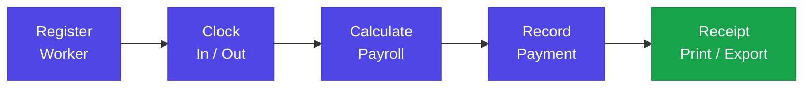
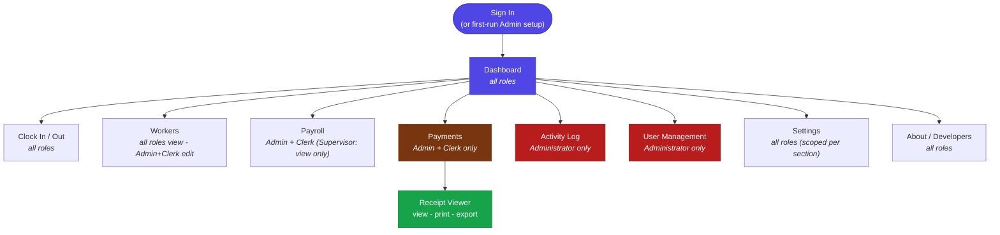
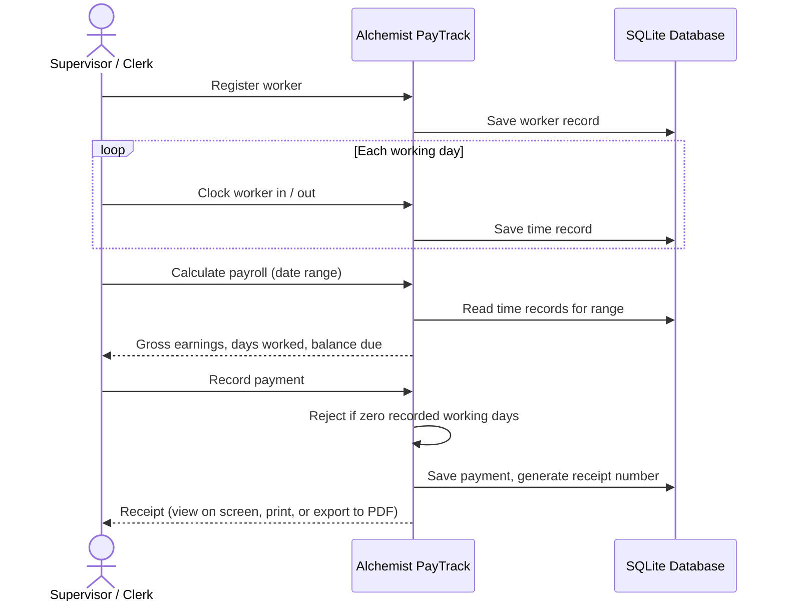
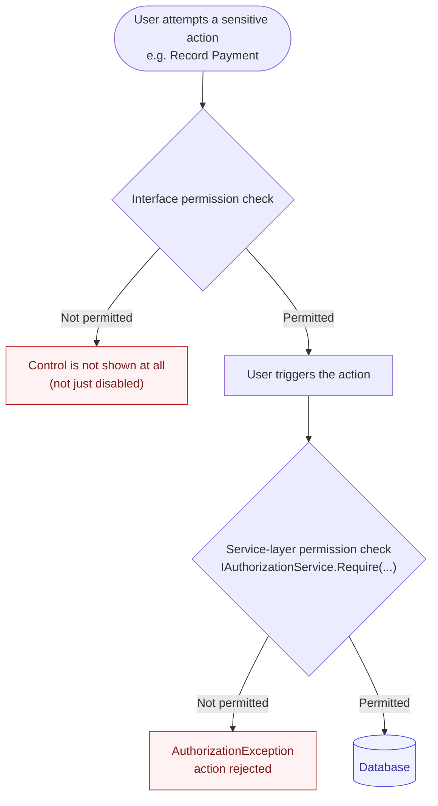
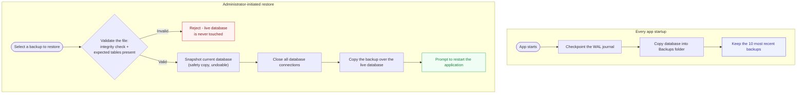
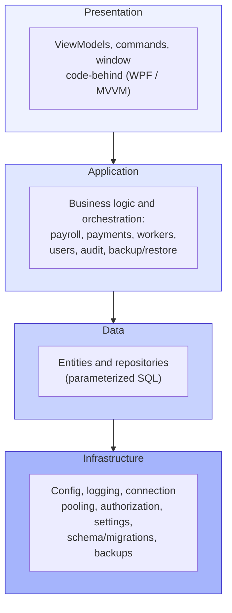
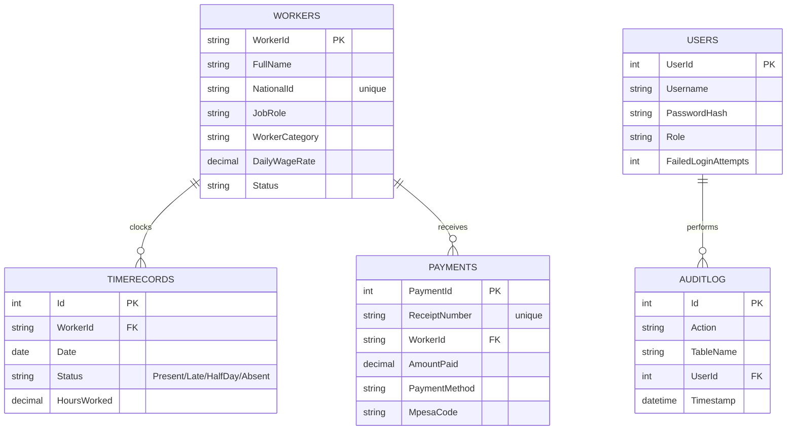

# Alchemist PayTrack


Alchemist PayTrack is an offline-first desktop application for managing
daily-wage and casual labor payroll: worker records, attendance, payroll
calculation, payments and receipts, reporting, and administration, all in
one tool built for Windows.

It is designed for organizations that pay workers by the day or by the hour
and need a dependable, self-contained system to track who showed up,
calculate what is owed, and record what has been paid, without depending on
an internet connection, a cloud subscription, or a recurring fee. Everything
runs on a single machine against a local database; install it once and it
keeps working.



This document is intentionally thorough. It covers what the application
does, how it is built, how its security model works, how to install and run
it, how to build it from source, and how to maintain it in production. If
you only need the short version: install the app, create an administrator
account on first launch, fill in your company details under Settings, add
your workers, and you're ready to track attendance and pay people.

---

## Table of contents

1. [Who this is for](#who-this-is-for)
2. [Feature overview](#feature-overview)
3. [Application map](#application-map)
4. [Walkthrough of every page](#walkthrough-of-every-page)
5. [Roles and permissions](#roles-and-permissions)
6. [Security model](#security-model)
7. [Backup and restore](#backup-and-restore)
8. [Reports, receipts, and exports](#reports-receipts-and-exports)
9. [Technology stack](#technology-stack)
10. [Architecture](#architecture)
11. [Database](#database)
12. [System requirements](#system-requirements)
13. [Installing the application (end users)](#installing-the-application-end-users)
14. [Building from source (developers)](#building-from-source-developers)
15. [Building the Windows installer](#building-the-windows-installer)
16. [Configuration and data locations](#configuration-and-data-locations)
17. [Project structure](#project-structure)
18. [Testing](#testing)
19. [Troubleshooting](#troubleshooting)
20. [Known limitations and roadmap](#known-limitations-and-roadmap)
21. [License and credits](#license-and-credits)

---

## Who this is for

Alchemist PayTrack is built for site managers, foremen, HR clerks, and small
business owners who run payroll for casual or day-rate workers - for
example in construction, agriculture, security services, cleaning
contractors, or similar labor-intensive operations where workers are paid by
the day and workforce turnover is common. It assumes:

- A single office or site running the app on one or a few Windows machines.
- A small internal team (an owner/administrator, one or more supervisors who
  manage day-to-day attendance, and one or more clerks who register workers
  and handle payroll and payments).
- A need for an auditable, permission-controlled system rather than a
  spreadsheet that anyone can edit.

## Feature overview

- **Worker management** - register workers with their daily wage rate, job
  role (chosen from a configurable list, not free text), category
  (Casual/Contract/Permanent), gender, phone number, and national ID.
  Search, filter by category or status, and page through the roster. Import
  many workers at once from a CSV file.
- **Time and attendance** - a simple clock in / clock out flow for daily
  attendance. A live view of who is present and who is absent today, with
  its own search box, that can be printed or exported to a branded PDF.
- **Payroll calculation** - pick a date range (or use the built-in "this
  week" / "this month" presets) and calculate gross earnings, days worked,
  hours worked, amount already paid, and outstanding balance for every
  worker in one pass. Export the result to a formatted Excel workbook or a
  branded PDF report.
- **Payments and receipts** - record a cash, M-Pesa, or bank transfer
  payment against a worker's balance, with a live balance-due hint as you
  type and one-click "use this week's balance" / "use this month's balance"
  shortcuts. Every payment produces a numbered receipt that can be viewed on
  screen, printed, or exported to PDF - individually or in bulk (select
  several payments and print or export all of their receipts as a single
  job). A worker who has never clocked a single day cannot be paid; the app
  blocks this both in the interface and in the underlying service, so it
  cannot be bypassed.
- **Company profile** - set the company name, currency, default daily wage
  rate, contact person, phone, email, postal address, and tax/registration
  number (e.g. a KRA PIN). These details appear on every exported or printed
  document - payroll reports, receipts, and attendance reports alike - so
  nothing that leaves the app is unbranded.
- **Configurable job roles** - maintain the list of job roles (Mason,
  Electrician, Security Guard, and so on) from Settings. The worker
  registration and edit form offers this list as a dropdown rather than a
  free-text field, so "Mason", "mason", and "Masons" can never end up as
  three different values in your data.
- **Backup and restore** - a backup is taken automatically every time the
  app starts (the most recent ten are kept), and a manual backup can be
  triggered at any time. A previous backup can be restored from within the
  app: the candidate file is validated (checked for structural integrity
  and the tables this app expects) before anything happens to the live
  database, and a safety snapshot of the current data is taken automatically
  immediately before the restore, so a restore of the wrong file can itself
  be undone. The app restarts itself cleanly after a successful restore so
  nothing already loaded in memory can show stale data.
- **Role-based access control** - three fixed roles (Administrator,
  Supervisor, Clerk), each limited to exactly what that role needs. A
  control a role cannot use is not merely disabled in the interface, it is
  removed from view entirely, and every sensitive action is checked again by
  the underlying service - not only by the interface - so permissions cannot
  be bypassed by any other path into the same functionality.
- **Activity log** - a searchable audit trail of who did what and when,
  available to administrators.
- **Account security** - passwords are hashed with bcrypt, checked against a
  password strength policy and password history, expire on a schedule, and
  accounts lock out automatically after repeated failed sign-in attempts.
  Sessions lock themselves automatically after a configurable period of
  inactivity.
- **Light and dark themes** - a full dark color theme, switchable from
  Settings, that covers every control in the application including dropdown
  menus and selected-row highlighting, not just the obvious surfaces.

## Application map

Every page hangs off a single main window; the sidebar switches between them
based on the signed-in user's role. Pages with no note are visible to every
role; the rest are limited as shown.



## Walkthrough of every page

### Dashboard

The landing page after sign-in. Shows today's, this week's, and this
month's payroll totals at a glance, a short trend chart, and a feed of
recent activity. Visible to every role.

### Clock In / Out

Search for a worker (by name, phone, or national ID) and clock them in or
out. Below that, a live "Today's Attendance" panel lists who is present and
who is absent right now, with its own independent search box (by name,
phone, national ID, or job role) and running counts. Present/absent data can
be printed or exported as a branded PDF report directly from this page.

### Payroll

Pick a year and month, or a custom date range, and calculate payroll for
every active worker in that period: days worked, hours worked, gross
earnings, amount already paid, and balance still owed. Export the result to
a formatted Excel workbook (branded header, colored header row, alternating
row shading, currency formatting) or a branded PDF report. Only roles with
permission to generate payroll or view its summary can reach this page at
all.

### Payments

Search for and select a worker, see their outstanding balance for the
current week and month with one-click shortcuts to pre-fill the payment
amount, choose a payment method (Cash, M-Pesa, Bank Transfer), and record
the payment. A numbered receipt is produced immediately and can be viewed,
printed, or exported. The payment history below the form lets you view,
select, and bulk-print or bulk-export receipts for any past payments. A
worker with zero recorded working days cannot be paid - the button is
disabled with a clear explanation before you even try, and the underlying
service rejects the attempt too if it were ever reached some other way.

The end-to-end flow from a fresh worker to a printed receipt looks like
this:



### Workers

The full worker roster: search, filter by category or status, and page
through results. Register a new worker or edit an existing one through a
form that includes a job-role dropdown sourced from Settings (see below),
so roles stay consistent across the whole roster. Import many workers at
once from a CSV file (columns: FullName, NationalId, PhoneNumber, Category,
JobRole, DailyWageRate). Deactivating a worker is a soft delete - their
history is preserved for payroll and audit purposes, they simply stop
appearing as an active worker for clocking in or generating new payroll.

### Activity Log

A paginated, searchable record of every significant action taken in the
app - who did it, when, and what changed. Available to administrators only.

### User Management

Create, deactivate, and reactivate user accounts, and assign them one of
the three roles. Available to administrators only. The very first account
in a fresh installation is created through a dedicated "set up your
administrator account" screen shown automatically before any sign-in is
possible.

### Settings

- **Company & Payroll Defaults** - company name, currency code, default
  daily wage rate, contact person, phone, email, address, registration
  number, website, and the light/dark theme toggle.
- **Job Roles** - add or remove the job roles offered on the worker
  registration/edit form. See [below](#configurable-job-roles-in-detail)
  for how this interacts with existing worker data.
- **Backup & Data Safety** - trigger a manual backup, open the backup
  folder, and (administrators only) restore from a previous backup.
- **Login Security Policy** - the number of failed sign-in attempts before
  an account locks, how long that lockout lasts, and how many minutes of
  inactivity before a session locks itself automatically.
- **Change My Password** - available to every signed-in user for their own
  account, enforcing the same password policy as account creation.

### About / Developers

App information and a direct way to reach support by email, WhatsApp, or
phone. Visible to every role.

#### Configurable job roles in detail

Job roles are stored centrally in the application's settings rather than
being typed freely on each worker's record. When registering or editing a
worker, the "Job Role" field is a dropdown populated from this list, so
"Mason", "mason", and "Masons" can never end up as three different values
cluttering your reports. If a worker's existing role isn't in the current
list - for instance, because the app was upgraded from an older version, or
the worker's data came in through a CSV import with a custom value, or an
administrator later removed that role from the list - the edit form will
still show that worker's actual current value rather than silently blanking
it; it simply won't be a permanent part of the dropdown unless an
administrator adds it there deliberately.

## Roles and permissions

Access is organized around three fixed roles. Custom or dynamic roles are a
deliberate non-feature: the application is built around exactly these three,
each with a fixed, reviewable set of permissions, rather than an
open-ended role editor that could accumulate inconsistent, unreviewed
permission combinations over time.

| Capability | Administrator | Supervisor | Clerk |
|---|:---:|:---:|:---:|
| Manage user accounts | Yes | | |
| Change system settings (company profile, job roles, security policy) | Yes | | |
| View the activity log | Yes | | |
| Manage / restore backups | Yes | | |
| Register / edit workers | Yes | | Yes |
| Deactivate workers | Yes | | |
| View workers | Yes | Yes | Yes |
| Clock workers in/out | Yes | Yes | Yes |
| Edit attendance / approve corrections | Yes | Yes | |
| Generate payroll | Yes | | Yes |
| View payroll summary (read-only) | Yes | Yes | |
| Record payments | Yes | | Yes |
| Print/export payment receipts | Yes | | Yes |
| View reports | Yes | Yes | Yes |
| Export reports | Yes | | Yes |

A role that has no reason to see a screen does not see it at all - for
example, a Supervisor does not have a Payments tab at all, rather than a
visible but disabled one, because Supervisor holds none of the permissions
that page is for. Every action a role is not permitted to take is also
rejected by the underlying service if it were ever reached by some other
path (a different button, a future feature, a bug in a visibility binding),
so permissions are enforced consistently rather than only cosmetically. This
matters in practice: several of the checks described above exist at both
layers independently - the interface hides what you shouldn't see, and the
service refuses what you shouldn't be able to do, and neither depends on the
other to be correct.



This is why the two checks are drawn as independent gates rather than one
feeding the other: a role that isn't supposed to do something can't do it,
whether it tries through the intended screen, a different one, or a future
feature that forgets to hide the button.

## Security model

- **Password hashing** - bcrypt via BCrypt.Net-Next, never a reversible or
  fast hash.
- **Password policy** - minimum strength requirements enforced on both
  account creation and password changes, plus a password history check (a
  password recently used cannot be reused) and a configurable expiry
  schedule.
- **Account lockout** - after a configurable number of failed sign-in
  attempts (default 5), the account locks for a configurable duration
  (default 15 minutes), both adjustable from Settings.
- **Session idle timeout** - after a configurable number of minutes with no
  mouse or keyboard activity (default 15), the session locks itself and
  requires signing in again.
- **Server-side permission enforcement** - every sensitive service method
  (registering a worker, recording a payment, restoring a backup, managing
  users, and so on) independently verifies the signed-in user's role holds
  the required permission before doing anything, throwing a dedicated
  `AuthorizationException` if not. This is a deliberate second layer,
  separate from - and not dependent on - the interface hiding the same
  controls.
- **Parameterized SQL throughout** - no string-concatenated queries
  anywhere in the data layer.
- **Path safety on restore** - a restore request only ever accepts a bare
  file name, resolved inside the application's own backup folder; it can
  never be pointed at an arbitrary path on disk.

## Backup and restore



- An automatic backup runs every time the application starts. The most
  recent ten backups are kept; older ones are deleted automatically.
- A manual backup can be triggered at any time from Settings, and the
  backup folder can be opened directly from the same screen.
- Because the database runs in WAL (write-ahead log) mode, a plain copy of
  the database file alone could in principle miss the most recently
  committed transactions, which briefly live in a separate file until
  checkpointed. Every backup - automatic, manual, or the safety snapshot
  taken before a restore - forces a checkpoint first, so the single file
  that gets copied is always complete and self-consistent on its own.
- **Restoring** a backup (administrators only) validates the candidate file
  before touching anything: it is opened read-only, checked for structural
  integrity, and confirmed to contain the tables this application expects.
  A file that fails this check is rejected outright and the live database
  is left completely untouched. Only after that check passes does the
  restore proceed - and even then, a safety snapshot of the current
  (about-to-be-replaced) database is taken automatically first, so
  restoring the wrong backup can itself be undone.
- After a successful restore, the application prompts to restart itself
  immediately as a clean new process, rather than continuing in the same
  session. This is deliberate: everything currently held in memory - the
  signed-in user's own account record, every loaded worker/payroll/payment
  list, cached settings - could reference data that no longer matches what
  is now on disk, and a full restart is the only way to guarantee nothing
  stale is left behind.

## Reports, receipts, and exports

Every exported or printed document - the payroll Excel workbook, the
payroll PDF report, individual and bulk payment receipts, and the
attendance report - shares the same visual identity: a gradient header
banner in the application's brand color, the company name and details from
Settings, and a consistent footer. Receipts additionally include signature
lines ("Received by" / "Authorized by") for a physical, presentable
document. Printing goes straight through Windows' own print pipeline (or,
for receipts, WPF's native print API rendering the on-screen receipt
directly) rather than requiring a separate PDF viewer to be open first,
though a PDF reader (virtually always present on a modern Windows install,
e.g. Microsoft Edge) is what actually receives the print job for
PDF-based reports.

## Technology stack

- **WPF (.NET 10, `net10.0-windows`)** for the desktop interface, using the
  MVVM (Model-View-ViewModel) pattern throughout.
- **SQLite** (`Microsoft.Data.Sqlite`) for local storage, in WAL journal
  mode, accessed through a pooled connection layer for performance under
  concurrent access from multiple pages of the app.
- **Microsoft.Extensions.DependencyInjection** for dependency injection
  across the entire application - every service, repository, and ViewModel
  is constructor-injected and resolved from a single container built at
  startup.
- **BCrypt.Net-Next** for password hashing.
- **QuestPDF** for every generated PDF (payroll reports, receipts,
  attendance reports).
- **ClosedXML** for the payroll Excel export.
- **CommunityToolkit.Mvvm** utilities alongside a small set of
  purpose-built `RelayCommand`/`AsyncRelayCommand` implementations already
  in the codebase.
- **xUnit** and **Moq** for the test suite.

## Architecture

The codebase is organized into four layers, each only depending on the
layers "below" it:



Key architectural decisions worth knowing about if you're extending this
codebase:

- **Dependency injection everywhere.** Every class that needs a
  collaborator receives it through its constructor, resolved by the DI
  container configured in `App.xaml.cs`. There is no service locator
  pattern and no `new SomeService()` scattered through the ViewModels.
- **Repository pattern for data access.** `Worker` and `TimeRecord` each
  have a dedicated repository behind an interface (`IWorkerRepository`,
  `ITimeRecordRepository`); other entities (payments, users, audit
  entries) are accessed directly through their service using the same
  pooled connection, which is an intentional, lighter-weight variation
  rather than an oversight.
- **Pooled SQLite connections.** `IConnectionPool` hands out and reclaims
  `SqliteConnection` instances rather than opening a fresh connection per
  query, and exposes a `CloseAllConnectionsAsync()` used specifically to
  release every handle (including SQLite's own native connection pool)
  before a restore overwrites the database file.
- **Permission enforcement at the service boundary, not just the UI.**
  `IAuthorizationService.Require(...)` / `RequireAny(...)` are called at
  the top of every sensitive service method. This is treated as a hard
  rule during development: a permission check that only lives in a XAML
  `Visibility` binding is considered incomplete.
- **A single settings file, not scattered configuration.** `AppSettingsData`
  is one plain object, serialized to JSON, that holds every user-facing
  setting (company details, job roles, security policy, theme). Adding a
  new setting means adding one property with a sensible default; existing
  installations upgrading to a newer version simply get that default for
  any setting their existing `settings.json` doesn't yet contain.
- **Exceptions are translated at the UI boundary, not sanitized everywhere.**
  Lower layers are free to include full technical detail in an exception's
  message (useful for logs); a small `UserMessage` helper in the
  Presentation layer decides what's safe to show on screen, defaulting to
  a generic, friendly message unless the exception is one of a small set
  deliberately written to be user-facing (`ValidationException`,
  `AuthorizationException`, and a couple of others). The full technical
  detail is always still written to the log file via the existing
  `ILogger.LogError(...)` call at each catch site, so nothing is lost for
  diagnosing a problem later - it just isn't shown to whoever is running
  payroll that day.

## Database

SQLite, one file, stored under the application's data folder (see
[Configuration and data locations](#configuration-and-data-locations)).
Tables are created automatically on first run and migrated automatically on
every subsequent start (`DatabaseInitializer` in `Infrastructure.cs`) - there
is no manual migration step to run.



| Table | Purpose |
|---|---|
| `Users` | Login accounts: username, bcrypt password hash, role, lockout state, password history |
| `Workers` | Worker roster: name, national ID (unique), phone, category, job role, daily wage rate, status |
| `TimeRecords` | One row per worker per day: clock in/out times, hours worked, status (Present/Late/HalfDay/Absent) |
| `Payments` | Payment history: receipt number (unique), worker, amount, method, M-Pesa code, timestamp |
| `AuditLog` | Action, table, record ID, actor, before/after values, timestamp, device |

Foreign keys are enforced (`PRAGMA foreign_keys=ON`), and the database runs
in WAL journal mode for better concurrent read/write performance.

## System requirements

**To run the installed application:**
- Windows 10 or later (64-bit)
- No additional runtime installation needed if using the published
  self-contained executable; the .NET 10 runtime is bundled

**To build from source:**
- Windows 10 or later (WPF requires Windows to build and run)
- [.NET 10.0 SDK](https://dotnet.microsoft.com/download) or later
- (Optional, for building the installer) [Inno Setup](https://jrsoftware.org/isdl.php)

## Installing the application (end users)


1. Obtain the installer (`AlchemistPayTrackSetup.exe`, produced by
   `installer.iss`) or the standalone executable from a `publish/` build.
2. Run it and follow the prompts. Installation does not require
   administrator privileges by default (it installs for the current user);
   an administrator install is offered as an option during setup.
3. On first launch, you will be asked to create the administrator account -
   this is the only time the app runs without requiring sign-in first.
4. From Settings, fill in your company name, currency, contact details,
   and registration number - these will appear on every report and receipt
   from then on.
5. From Settings, review or adjust the list of job roles for your
   organization.
6. From User Management, create accounts for your supervisors and clerks
   with the appropriate role.
7. From Workers, register your workforce (or import them from a CSV file).
8. You're ready to clock workers in, run payroll, and record payments.

## Building from source (developers)

```
git clone <this repository>
cd RefactoredPaytruck
build.bat
```

or, from PowerShell:

```
.\build.ps1
```

This restores NuGet packages, builds the solution in Release configuration,
runs the full test suite, and publishes a self-contained `win-x64`
executable to `publish/AlchemistPayTrack.exe`.

To run the app directly during development, without a full publish:

```
run.bat
```

or `.\run.ps1` from PowerShell.

To clear build output and start fresh:

```
clean.bat
```

Add `--reset-app-data` to also clear the local database, settings, and
backups (useful when you want a truly clean first-run experience for
testing):

```
clean.bat --reset-app-data
```

### Running the tests directly

```
dotnet test AlchemistPayTrack.Tests
```

## Building the Windows installer

With [Inno Setup](https://jrsoftware.org/isdl.php) installed:

1. Run `build.bat` first, so `publish/AlchemistPayTrack.exe` exists.
2. Open `installer.iss` in Inno Setup and compile it, or run it headlessly:
   ```
   "C:\Program Files (x86)\Inno Setup 6\ISCC.exe" installer.iss
   ```
3. The finished installer is written to
   `installer_output/AlchemistPayTrackSetup.exe`.

The installer script embeds the application's own icon
(`AlchemistPayTrack/Assets/AppIcon.ico`) as both the installer's icon and
the shortcut icon it creates.

## Configuration and data locations

All user data lives under the current Windows user's application data
folder, not inside the installation directory - this keeps the app working
correctly under a machine-wide (administrator) install where the program
files folder isn't writable by a normal user:

```
%AppData%\AlchemistPayTrack\
  AlchemistPayTrack.db      The SQLite database (plus -wal/-shm sidecar files)
  settings.json             Company details, job roles, security policy, theme
  Backups\                  Automatic and manual database backups
  Logs\                     Daily log files (LogsPath)
```

Nothing here needs to be edited by hand under normal use; `settings.json`
and the backup folder are both fully manageable from within the app's
Settings page.

## Project structure

```
AlchemistPayTrack/
  Infrastructure/     Configuration, logging, connection pooling, backups,
                       authorization, settings persistence, database
                       schema/migrations, export branding (gradient
                       headers, company details block shared by every
                       export), receipt and attendance PDF builders
  Data/                Entities (Worker, TimeRecord, PaymentRecord, etc.)
                       and the repository layer
  Application/         Business logic and services: payroll, payments,
                       workers, time records, users, audit
  Presentation/        ViewModels and view-level logic (MVVM)
  Assets/              Application icon
  Themes/              Light and dark color theme resource dictionaries
  MainWindow.xaml(.cs) The single-window shell; pages are DataTemplates
                       switched based on the active ViewModel
  LoginWindow.xaml(.cs) Sign-in / first-run administrator setup
  ReceiptWindow.xaml(.cs) In-app payment receipt viewer, printer, exporter
  App.xaml(.cs)        Startup, DI container configuration, theming,
                       global exception handling, session lifecycle

AlchemistPayTrack.Tests/
  Unit/                Unit tests for services and repositories, using
                       Moq for dependencies and an in-memory/mock
                       connection pool where appropriate

installer.iss          Inno Setup script for building the Windows installer
build.bat / build.ps1  Restore, build, test, and publish
run.bat / run.ps1       Run the app directly, without a full publish
clean.bat / clean.ps1   Clear build output (and optionally local app data)
```

## Testing

The test project (`AlchemistPayTrack.Tests`) covers the service and
repository layer using xUnit and Moq. Dependencies like
`IConnectionPool`, `IAuthorizationService`, and `ISettingsService` are
mocked so tests exercise business logic (payroll date-range calculation,
worker validation, time record repository behavior, and so on) without
touching a real database or requiring a signed-in user. Run the suite with:

```
dotnet test AlchemistPayTrack.Tests
```

or via `build.bat`, which runs it as part of every build.

## Troubleshooting

**The app won't start.** Check the log file under
`%AppData%\AlchemistPayTrack\Logs\` for the most recent entry - the
application writes full technical detail there even when the on-screen
message is deliberately kept simple (see [Security model](#security-model)
and the architecture note on exception translation above).

**I forgot the administrator password.** There is currently no built-in
password reset flow; an administrator with database access would need to
either restore an older backup where the password is still known, or the
account's password hash would need to be reset directly in the database.
This is a known limitation - see below.

**A payment won't record.** If the worker has zero recorded working days,
this is by design (see [Feature overview](#feature-overview)) - clock them
in for at least one day first.

**Restore says the backup file is invalid.** The file has failed an
integrity check or is missing tables this application expects, which means
it is not safe to restore from. The current, live database is never
touched in this case. Try a different, more recent backup from the list.

## Known limitations and roadmap

- No self-service "forgot password" flow; password resets currently require
  administrator/database-level intervention.
- Roles are fixed to the three described above; there is no custom-role
  editor. This is a deliberate design choice (see
  [Roles and permissions](#roles-and-permissions)), not an oversight, but it
  is worth knowing if your organization needs a different permission shape.
- `ApprovePayroll` and `ManageProjects` permissions are modeled in the
  authorization system in preparation for future features (a payroll
  approval workflow, and project/site-based worker tracking) but neither
  feature exists in the application yet.
- Single-machine, single-database design: there is no multi-site sync or
  server component. Each installation's data lives entirely in its own
  local SQLite file.

## License and credits

Alchemist PayTrack

Contact / Support: njorogefrancis.dev@gmail.com
Phone / WhatsApp: 0743274746
